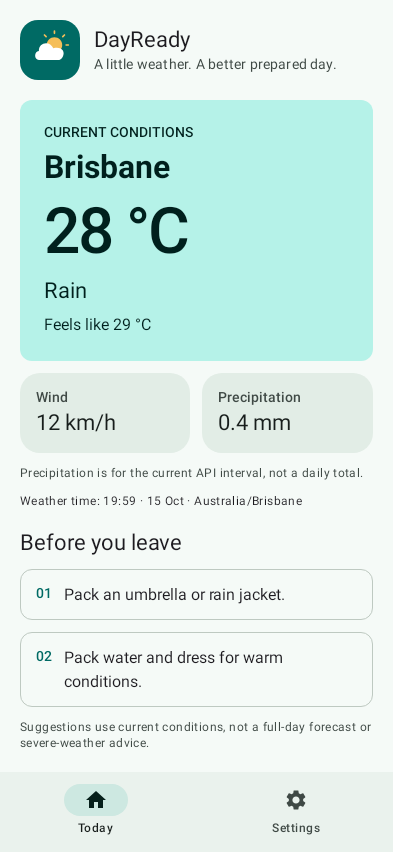

# DayReady

**A quick weather check before you head out.** DayReady shows current conditions and a short packing checklist, without an account, device-location permission or a complicated forecast dashboard.

Built for CP3406 / CP5307 Assessment 1 using the lecturer's single-activity Compose starter structure. The two-screen navigation and original package name are retained.

## What it does

- **Current conditions:** temperature, feels-like, WMO condition, wind, precipitation and a timestamp in the selected city's timezone.
- **Before you leave:** transparent rules suggest rain gear, extra layers, water, wind preparation or snow clothing. Thunderstorms prompt users to check local warnings first. These are suggestions, not a safety assessment or full-day forecast.
- **Personal settings:** five city-centre locations, Celsius/Fahrenheit, checklist visibility and device/light/dark appearance. Changes apply immediately.
- **Lifecycle support:** ViewModel state survives rotation. `SavedStateHandle` restores settings if Android restores the session after process death; `rememberSaveable` restores the selected tab. Settings need not persist across fresh sessions for this assignment.
- **Honest failure states:** missing API fields are rejected; failed refreshes retain previous weather with an explicit warning. Switching cities clears previous-city data. Old in-flight responses cannot overwrite a newer request.
- **Material 3 presentation:** consistent teal/sun branding and a matching adaptive launcher, accessible labelled controls, scrollable layouts, a two-column layout on wide screens, and stacked metrics at larger text sizes.

## Rendered screen



Rendered from the app’s Compose UI in a host test. Weather values are synthetic; see [screenshot evidence](docs/screenshots/README.md).

## Build and run

Use Android Studio with a **full JDK 21** (including `javac`), Android SDK platform **36**, and build-tools **35.0.0**. The wrapper pins Gradle **8.13**; the version catalog pins AGP **8.13.2** and Kotlin **2.0.21**. Do not substitute Gradle 9. Use the Gradle JDK setting or `JAVA_HOME` to select the full JDK; a Java runtime alone is insufficient.

1. Open the project folder containing `settings.gradle.kts` in Android Studio.
2. Install the SDK components and sync Gradle with internet access.
3. Run `app` on a device or emulator running Android 8 / API 26 or later.
4. Allow internet access. The initial request uses Brisbane; choose another city in Settings.

```sh
# macOS/Linux; Windows uses gradlew.bat with the same tasks
bash gradlew testDebugUnitTest lintDebug assembleDebug
# With a running emulator or connected device:
bash gradlew connectedDebugAndroidTest
```

The debug APK is generated at `app/build/outputs/apk/debug/app-debug.apk`. Robolectric runs two Compose interaction tests on the host without an emulator; its caches are isolated under the Gradle user home. Unit test and lint reports are under `app/build/reports/`. GitHub Actions runs the unit tests, lint and APK build on pushes and pull requests; see `.github/workflows/android.yml`.

Local validation: 25 tests (including host-side Compose interaction/restoration), lint with no errors, and both app/test APK builds passed. Five additional device tests compile but remain unrun because the unaccelerated emulator did not complete first boot. A live API endpoint check passed.

No API key is required. See [TESTING_CHECKLIST.md](TESTING_CHECKLIST.md) for checks and the distinction between automated evidence and manual checks.

## How it works

```text
MainActivity → WeatherViewModel → WeatherRepository → WeatherApi → Open-Meteo
                       ↓
                 WeatherUiState → UtilityApp → Weather / Settings
```

`DayReadyApplication` owns `AppContainer`, which constructs an OkHttp client with timeouts, Retrofit/Gson and the network repository. `MainActivity` injects the repository through the ViewModel factory and collects `StateFlow` with `collectAsStateWithLifecycle`. Compose receives immutable state and event callbacks; network calls and request cancellation stay in the ViewModel. The repository validates response values before exposing the domain model.

Celsius remains the internal unit, even when Fahrenheit is displayed. Wind is km/h. Precipitation is mm for the API's current interval, not a daily total. Observations at least 30 minutes old are labelled as previous conditions; this age is calculated using the API city timezone, including fractional offsets. Display changes do not make new network requests.

Read [FILE_GUIDE.md](FILE_GUIDE.md) for source responsibilities and [docs/REQUIREMENTS.md](docs/REQUIREMENTS.md) for the rubric mapping.

## Sources and attribution

- Lecturer-provided CP3406 / CP5307 single-activity utility template: starting structure, package namespace and navigation concept. DayReady's weather logic, UI composition, teal/sun theme and vector mark are additions to that starter.
- Weather data: [Open-Meteo](https://open-meteo.com/), [CC BY 4.0](https://creativecommons.org/licenses/by/4.0/). Uses the [non-commercial forecast endpoint](https://open-meteo.com/en/docs). These are weather-model conditions, not personal weather-station measurements. Follow [API terms](https://open-meteo.com/en/terms).
- [Retrofit](https://square.github.io/retrofit/), [Android architecture guidance](https://developer.android.com/topic/architecture), [Material 3](https://m3.material.io/), and [AGP compatibility](https://developer.android.com/build/releases/agp-8-13-0-release-notes).
- Generative AI assisted implementation and documentation. Review and adapt the declaration guidance in [REFLECTION_AND_AI_GUIDANCE.md](REFLECTION_AND_AI_GUIDANCE.md) to the subject's official form and permitted-use rules.

## Submission and limits

Export the Android project from Android Studio using **File → Export → Export to ZIP**. Submit it with your GitHub link, access for the lecturer/coordinator, your own **500–1000 word, 1–2 page Gibbs reflection**, and the required AI declaration. The PDF has a word-count typo in one paragraph; its submission section specifies 500–1000 words.

The first 50 commits add components from one supplied ZIP snapshot. They do not establish development spread across weeks. Subsequent commits should document actual changes and the student's own review and testing; do not backdate commits or claim activities that did not occur.

This app uses preset city centres, not live GPS. It has no persistent disk weather cache, background refresh, daily forecast or severe-weather alert service. English is the provided language; music and language controls on the feedback sheet are examples of possible settings, not mandatory requirements in the assignment PDF. There is no completed personal reflection in this repository.
